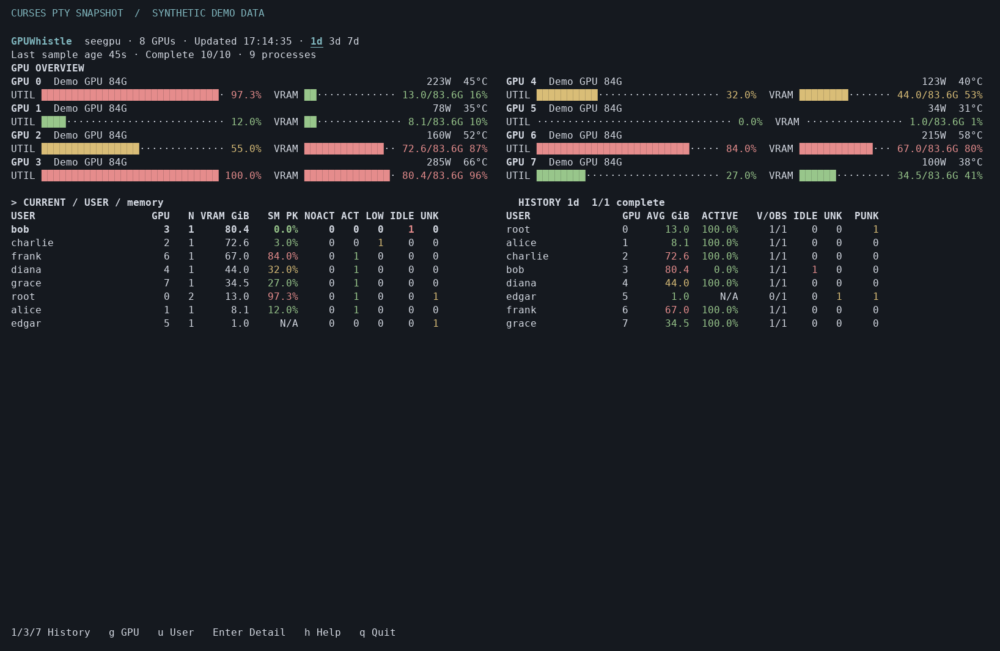

# GPUWhistle · GPU 吹哨人

**Your GPUs are occupied. But are they actually working?**

**显存被占用，不代表 GPU 正在工作。**

GPUWhistle is a lightweight, read-only NVIDIA GPU auditing tool for shared Linux servers. See who holds GPU memory, inspect process activity evidence, and review sampled usage over the last 1, 3, or 7 days—all in a curses terminal UI backed by local SQLite.

[中文说明](README.zh-CN.md) · [Quick start](QUICKSTART.md) · [MIT license](LICENSE)



*Terminal preview with synthetic example data.*

## What it does

- Groups visible GPU processes by Linux UID and GPU UUID, with observed VRAM totals.
- Uses NVML process utilization evidence for ACTIVE, LOW_ACTIVITY, NO_ACTIVITY_OBSERVED, SUSPECTED_IDLE, and UNKNOWN states.
- Keeps unknown processes visible even when another process owned by the same user is active.
- Stores window summaries in SQLite and reports rolling 24/72/168-hour usage, including per-date groups.
- Provides a compact terminal dashboard, CSV/JSON export, diagnostics, and user-level scheduling.
- Runs without sudo, CUDA Toolkit, PyTorch, a web server, or a database service.

GPUWhistle never runs GPU kernels, creates a CUDA compute context, kills processes, or releases someone else's memory.

## Requirements

Linux, Python **3.9+** with `venv`, `pip`, and curses, an existing NVIDIA driver/NVML installation, and permission to read the devices and relevant process information. Installation does not install or modify GPU drivers. Restrictive `/proc` settings, containers, MPS, and driver capabilities can limit attribution.

## Install and open

```bash
git clone https://github.com/WengJGo/GPUWhistle.git
cd GPUWhistle
source ./setup.sh
seegpu
```

Run `source` in **Bash** to make `seegpu` immediately available in the current terminal. `bash setup.sh` also installs the program; open a new terminal afterward.

The full setup creates an isolated user virtual environment, adds a managed PATH block, preserves existing configuration, samples once, and installs a user-level periodic sampling job. To install without sampling or scheduling:

```bash
source ./setup.sh --no-sample --no-schedule
seegpu doctor
seegpu once
seegpu
```

`./install.sh` performs only package installation. Python dependencies are fetched from the package index for source installations; a locally built portable archive includes runtime wheels for offline installation. A working Python/venv and NVIDIA driver are still required.

The existing commands **`seegpu` and `gpumonitor`** remain compatible. The internal Python module, XDG directory names, and managed scheduler identifiers remain `gpumonitor` to preserve existing installations. The public distribution name is `gpuwhistle`.

## Sampling and scheduling

Default: every **600 seconds**, sample for **10 seconds**, reading once per second. Each collector exits afterward and releases NVML. The TUI only refreshes SQLite; refreshing the page never queries NVML.

```bash
seegpu once
seegpu once --duration 60 --interval 1
seegpu schedule install
seegpu schedule status
seegpu schedule remove
```

Full `setup.sh` enables automatic collection by default and prefers a user **cron** entry when `crontab` is available, so collection continues after SSH logout. Otherwise it uses the automatic scheduler backend. Setup returns an error if schedule installation fails; use `--no-schedule` only to opt out deliberately.

The explicit `seegpu schedule install` command prefers a systemd **user** timer. A user manager without linger may stop after logout. GPUWhistle does not change linger or administrator configuration. If the system cron daemon is available, use:

```bash
seegpu schedule install --backend cron
```

Cron checks once per minute and samples only when the current configured period is due; its period must be a whole-minute multiple. Machines that are off or inaccessible do not backfill missing observations. Remove the schedule to stop future automatic collections. A manually running `once` can be interrupted with Ctrl+C; `q` closes the UI.

## Terminal controls

| Key | Action |
| --- | --- |
| `q` | Quit immediately |
| `h` / `?` | Keyboard help |
| `1` / `3` / `7` | Last 24 / 72 / 168 hours |
| `g`, Left / Right; `a` | Cycle GPUs; show all GPUs |
| `u` | Users / processes |
| Up / Down, Enter | Select a user; open details |
| Tab, PgUp / PgDn, Home / End | Focus and scroll tables |
| `n` / `m` / `i`, `s` | Sort by name / memory / idle streak; cycle sort |
| `d`, `r`, Space | Per-date history, refresh database, pause UI refresh |

80-column terminals use compact stacked tables; wide terminals use two-column GPU cards and side-by-side current/history panels. Non-TTY execution prints a text report. Colors use standard curses capabilities and the terminal's default background.

```bash
NO_COLOR=1 seegpu
GPUMONITOR_ASCII=1 seegpu
```

## Reports and exports

```bash
seegpu report --days 1
seegpu report --days 3
seegpu report --days 7
seegpu report --user alice --gpu 0 --days 7
seegpu report --days 7 --daily
seegpu export --days 7 --format csv > usage.csv
seegpu export --days 7 --format json > usage.json
```

GPU UUID is stable; an index filter refers to the index recorded in each window. JSON exports also include GPU-wide window power trends. CSV memory values are bytes, timestamps are Unix seconds, and ratios are 0..1. A seven-day query only reports observations actually collected.

### Read the counters correctly

CURRENT `NOACT`, `ACT`, `LOW`, `IDLE`, and `UNK` are **process counts** and sum to `N`. `NOACT` means explicit zero activity in this sample, pending the required consecutive windows; it is separate from suspected `IDLE` and `UNKNOWN`. Select a user and press Enter to see each PID, memory, evidence, and idle streak. `r` only rereads SQLite: if the sample is stale, run `seegpu once` and check `seegpu schedule status` in another shell. `SM AVG` and `SM PK` summarize valid observed process SM samples; user-level `SM PK` is the maximum process peak, **not** the user's overall GPU utilization. `SM COV` measures valid sample coverage, not time spent working. Older windows without SM-specific coverage display N/A.

HISTORY uses different units:

| Field | Meaning |
| --- | --- |
| ACTIVE | Active user windows / activity-determinable user windows; ACTIVE and LOW_ACTIVITY both provide activity evidence |
| V/OBS | Activity-determinable / observed user windows |
| IDLE | User windows containing at least one suspected-idle process |
| UNK | User activity could not be determined: no activity evidence and at least one UNKNOWN process |
| PUNK | UNKNOWN **process-window observations**, including windows where another process is active |

For a window with one ACTIVE and one UNKNOWN process, user ACTIVE may be 100% and UNK=0, while PUNK=1 and the process UNKNOWN ratio is 1/2. Details and JSON/CSV expose `process_windows`, `unknown_process_windows`, `windows_with_unknown_processes`, and `unknown_process_ratio` independently.

Memory averages mean **window-average observed ownership**, conditional on the user being seen and usable memory readings being available. Missing users are not filled with zero. Windows are equally weighted. Active and idle ratios use their respective determinable-window denominators; a user can have both an active and a suspected-idle process. The planned window count is an estimate using the current period, not a scheduler event ledger.

## Configuration and local data

```bash
mkdir -p ~/.config/gpumonitor
cp config.example.json ~/.config/gpumonitor/config.json
```

| Setting | Default | Meaning |
| --- | --- | --- |
| `duration`, `interval`, `period` | 10, 1, 600 seconds | Require interval ≤ duration ≤ period |
| `retention_days` | 30 | Delete summaries older than this many days on every collection write, including failed windows |
| `idle_memory_bytes` | 1073741824 | Observed memory floor for suspected idle |
| `idle_windows` | 3 | Consecutive valid windows required |
| `active_threshold` | 10 | Observed engine percentage distinguishing ACTIVE from LOW_ACTIVITY |
| `min_util_coverage` | 0.6 | Minimum explicit sample coverage for inactivity evidence |
| `database` | empty | Use the XDG data location, or specify a writable path |

Default configuration: `~/.config/gpumonitor/config.json`; database: `~/.local/share/gpumonitor/history.db`. `XDG_CONFIG_HOME` / `XDG_DATA_HOME` are respected. Custom configuration goes **before** the subcommand: `seegpu --config ./config.json once`. No per-second raw samples are retained. New database files are created with owner-only permissions (0600). Existing database permissions are preserved. SQLite uses WAL, transactions, a busy timeout, and a collection lock. Deleted database pages are reused; file size may not shrink immediately.

Optional UI theme: copy `theme.example.json` to `~/.config/gpumonitor/theme.json`. GPU color boundaries default to `[30, 80]`, VRAM to `[50, 80]`, independently configurable. Theme thresholds affect display only. `GPUMONITOR_THEME` selects another theme file.

## Measurement limits

**This is sampled inspection, not continuous monitoring.** The default nominal time coverage is about **1.67%**. GPU activity between windows is unknown. NO_ACTIVITY_OBSERVED and SUSPECTED_IDLE do not prove a process was idle for the full ten-minute interval.

NVML can return only processes with nonzero activity. Missing samples are **not zero**. GPUWhistle only assigns samples to a verified PID + process start time + boot identity, filters timestamps to the window, and deduplicates samples. Unknown memory/utilization remains unknown. Inactivity requires sufficient explicit valid zero samples; a driver that omits quiet processes may leave them UNKNOWN indefinitely. This conservative behavior is intentional.

Suspected idle additionally requires memory above the configured floor at every observation and repeated valid windows. Unknown windows, missing critical data, identity changes, process disappearance, or excessive window gaps break the streak. GPU-Util is card-wide; allocated VRAM is not computing activity, and process SM values must not be summed into a fabricated user utilization rate.

MIG is detected but instances are not expanded. Unsupported utilization and ambiguous MIG process memory are N/A. MPS and container PID namespaces can prevent final application-user attribution. Power belongs to the entire GPU; GPUWhistle does not estimate precise per-user energy use.

## Uninstall

```bash
./uninstall.sh
```

Only managed entry points, virtual environment, PATH blocks, and scheduled jobs are removed. Source, user configuration, and historical data are retained. For a custom `GPUMONITOR_PREFIX`, use the same prefix for installation and removal.

## Development

Run the software tests on Linux without a GPU:

```bash
python -m pip install -e '.[test]'
python -m pytest -q
```

Build a portable archive with runtime wheels:

```bash
python -m pip install setuptools wheel
python tools/build_release.py
```

## License

[MIT](LICENSE), copyright 2026 WenJGo. Dependency licenses are listed in [THIRD_PARTY_NOTICES.md](THIRD_PARTY_NOTICES.md).
