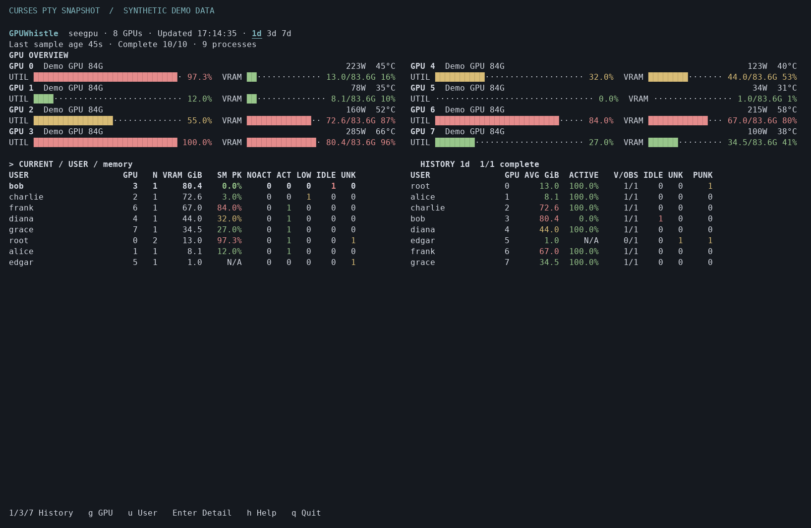

# GPUWhistle · GPU 吹哨人

**Your GPUs are occupied. But are they actually working?**

**显存被占用，不代表 GPU 正在工作。**

GPUWhistle 是面向 Linux 共享 NVIDIA GPU 的轻量、只读巡检工具：按用户查看显存和进程、分析进程活动证据、发现疑似闲置显存，保留最近 1/3/7/15/30 天的抽样历史。使用 curses 和本地 SQLite，无 Web、Docker 或额外数据库服务。



图片来自真实 curses 输出的渲染，全部数据均为虚构示例，不是生产服务器记录。完整参数、指标定义与英文说明见 [README](README.md)。

## 安装与启动

需要 Linux、Python >=3.9（含 venv/pip/curses）、已有 NVIDIA 驱动及设备和目标进程的必要读取权限。不需要 sudo，也不会安装或修改驱动。

```bash
git clone https://github.com/WengJGo/GPUWhistle.git
cd GPUWhistle
source ./setup.sh
seegpu
```

在 Bash 中使用 `source` 可让当前终端立即识别命令。完整 setup 会创建用户独立环境、配置 PATH、首次采样，并安装用户级定时任务。只安装、不采样和设置任务时使用：

```bash
source ./setup.sh --no-sample --no-schedule
seegpu doctor
seegpu once
seegpu
```

`seegpu` 与 `gpumonitor` 两个入口均保留。为兼容已有安装，内部 Python 模块、配置/数据库目录和任务标记继续使用 gpumonitor；对外软件与发行包名称为 GPUWhistle / gpuwhistle。

## 采集与历史

默认每 **600 秒**启动一轮，连续采集 **10 秒**、每秒读取一次；保存窗口汇总后退出。界面只读数据库，不因刷新页面而查询 NVML。

```bash
seegpu schedule install
seegpu schedule status
seegpu schedule remove
seegpu report --days 1
seegpu report --days 3
seegpu report --days 7
seegpu report --days 15
seegpu report --days 30
seegpu report --user alice --gpu 0 --days 7
seegpu report --days 7 --daily
seegpu export --days 7 --format json > usage.json
seegpu export --days 7 --format csv > usage.csv
```

完整 `setup.sh` 默认启用自动采集：存在 crontab 时优先用户 cron，以便退出 SSH 后继续运行；否则使用自动调度后端。启用失败时 setup 返回错误，不会报告全部配置成功。只有显式传入 `--no-schedule` 才跳过。

显式执行 `seegpu schedule install` 优先 systemd 用户 timer；未启用 linger 的用户 manager 可能随注销停止，本工具不修改管理员设置。系统 cron 可用时可选择 `seegpu schedule install --backend cron`。cron 周期须为整分钟倍数。机器关机期间不会补采。

`q` 直接退出界面，`h` 查看帮助，`1/3/7/5/0` 选择 1/3/7/15/30 天，`g` 切换 GPU，`u` 切换用户/进程，Enter 展开用户详情。Tab/翻页键操作表格。支持窄屏、宽屏、8/256 色、黑白与 ASCII：

```bash
NO_COLOR=1 seegpu
GPUMONITOR_ASCII=1 seegpu
```

## 即时查询集群空卡

复制 `cluster.example.json` 到 `~/.config/gpumonitor/cluster.json`，将 `nodes` 改成自己的服务器列表。每个节点包含显示名称 `name` 和 SSH 目标 `target`；`target` 为 `local` 时查询当前机器。真实机器地址、用户名及凭据只放本地配置。可用 `GPUMONITOR_CLUSTER` 指定另一份配置。

在界面按 **c**，立即并行查询全部配置节点，独立显示每台机器的进度及结果。上方汇总各机器空卡编号，下方优先列出空卡，并显示实际剩余显存、占用显存、GPU 利用率和进程数。视图在每轮完成后默认 **10 秒自动重查**，刷新期间保留上次读数并标明 refreshing，读数年龄不会被重置；各轮不重叠。某台失败时清除该台旧读数，自动重试。再次按 **c** 立即重新采集；**b** 或 Esc 返回原视图；方向键/翻页键浏览；**q** 退出并终止尚未完成的查询命令。该功能不写入历史，不改变定时采集，不创建 CUDA 上下文，也不预留 GPU。

绿色 **FREE** 同时要求：计算/图形进程列表明确为空、GPU 利用率为 0%、显存读数有效且占用不超过 `free_memory_mib`（默认 256 MiB，允许驱动开销）、仍有可用显存、非 MIG 模式、计算模式允许使用。**GPU 利用率 0% 但持有大量显存依然是 IN_USE。** 不支持、缺失及 MIG 信息不确定显示 UNKNOWN，连接失败显示 ERROR，绝不按空卡标绿。若结果仍超过 `stale_after`（默认 30 秒），转为 STALE 并取消绿色，汇总明确显示过期，不当作“没有空卡”。`refresh_interval` 默认 10 秒，实际间隔最多为过期时限的一半。返回原视图后停止集群自动查询；命令行仍只查询一轮。FREE 只表示本次快照未发现使用，不证明一直没人用，也不代表已为你锁定这张卡。

远端只需已有 `python3`、`nvidia-smi`、免交互 SSH 登录权限和已验证的主机公钥，无需安装 GPUWhistle 或额外 Python 依赖。查询启用 BatchMode 和严格主机密钥校验，不自动安装密钥、信任未知主机或询问密码。默认每台超时 12 秒，某台失败不会阻碍其他结果，也不会卡住界面。

```bash
seegpu cluster
seegpu cluster --format json
seegpu cluster --cluster-config ./cluster.json --format json
```

命令行在未配置节点或任一节点失败时返回非零状态，仍输出其他成功节点的数据。原来的 r 键继续只刷新 SQLite，c 才会触发即时查询。

## 历史闲置占用排行

按 **t** 切换到统计视图，按估算零活动占用时长从高到低排列，每行对应一个用户和一张 GPU。默认查看保留的最近 **30 天**，**历史占用者即使已经退出、释放显存，也会保留在统计中**。`5` 选择 15 天、`0` 选择 30 天，`1/3/7` 切换短周期（原 HISTORY 也支持同样的五档范围），`g` 筛选 GPU，方向键/翻页键浏览，Enter 查看证据，`t` 或 Esc 返回主界面，`q` 退出。原 CURRENT/HISTORY 指标含义保持不变。

| 字段 | 含义 |
| --- | --- |
| ZERO~ | 估算零活动占用时长：每个可靠零活动窗口折算一个采集周期，默认 10 分钟 |
| SAMP | 实际观测到的零活动窗口时长，默认每轮约 10 秒 |
| HELD~ | 所有状态的显存占用折算时长，包括 UNKNOWN |
| GiB | 可靠零活动进程的显存合计在命中窗口中的平均值 |
| PUNK | UNKNOWN 进程的窗口观测次数，不被同用户的 ACTIVE 掩盖 |

每个窗口按**截止本次观测时刻的前一个采集周期**折算，并裁剪到查询范围；重叠区间取并集。同一用户、同一 GPU 上并行进程或重复/手动采样不会重复累计时长，缺失窗口不补采，也不把最后采样到现在的时间继续累加。历史折算采用当前配置的采集周期。**这是基于采样的估算，不是确认整段时间都没有计算。**

只有完整窗口中身份可靠、有足够零活动证据、显存达到配置下限的 NOACT/疑似 IDLE 进程参与 ZERO~。ACTIVE、LOW、UNKNOWN 和显存未知均不按零活动算。同一用户可同时存在忙碌和闲置进程，统计只说明其中符合条件的进程持有显存，不代表整张卡闲置。Enter 可查看混合活动窗口数、最后一次观测的状态数量、最后出现/零活动时间、实际采样覆盖率等。没有零活动证据的历史用户也会列出，零活动显存显示 N/A。30 天之前已经删除的历史无法恢复。

命令行查看或导出相同排行（JSON/CSV 时长单位为秒，显存为字节）：

```bash
seegpu idle
seegpu idle --days 7 --user alice --gpu 0
seegpu export --days 30 --format csv > usage-30d.csv
seegpu idle --days 15 --format csv > idle-15d.csv
seegpu idle --days 30 --format csv > idle.csv
seegpu idle --format json > idle.json
```

## 配置与指标

将 `config.example.json` 复制为 `~/.config/gpumonitor/config.json`。数据库默认 `~/.local/share/gpumonitor/history.db`，新数据库以仅所有者可读写的 0600 权限创建，已有数据库权限保持不变，尊重 XDG 环境变量，可配置路径、采样时长/间隔/周期和 30 天默认保留时间。每轮采集写入时自动删除超过 30 天的记录，即使本轮 GPU 采集失败也会执行清理。`theme.example.json` 可用于独立配置负载颜色阈值，不影响活动或闲置判断。

CURRENT 的 NOACT/ACT/LOW/IDLE/UNK 是进程数量，合计为 N。NOACT 表示本轮明确观测到零活动、尚未达到连续窗口要求；IDLE 为达到条件的疑似闲置，UNK 是未知。选中用户按 Enter 可查看 PID、显存、样本覆盖率和连续零活动窗口数。`r` 只刷新数据库，不能启动采集；数据过旧时在另一个终端运行 `seegpu once` 并检查 `seegpu schedule status`。HISTORY 的 ACTIVE、IDLE、UNK 是用户窗口统计，PUNK 则是 UNKNOWN 进程的窗口观测次数。一个用户有 ACTIVE 和 UNKNOWN 两个进程时，用户 ACTIVE=100%、UNK=0 可以成立，同时 PUNK=1，进程 UNKNOWN 比例为 1/2。

SM 平均值和峰值只来自有效样本，覆盖率是样本覆盖而不是计算时间比例。用户 SM 峰值是各进程峰值的最大值，不能当作用户整体 GPU 利用率。缺失读数保留 N/A，UNKNOWN 不能当成零或空闲。显存平均是“用户被观测到持有显存时”的窗口平均，没看到用户的窗口不补零。

## 必须了解的限制

这是抽样巡检，**不是全天连续监控**。默认名义时间覆盖约 1.67%；两轮之间是否计算无法判断。疑似闲置要求可靠身份、足够的显式零样本、连续至少 3 个有效窗口和持续至少 1 GiB 显存观测；UNKNOWN 或关键缺失会中断计数。部分驱动只返回非零活动进程，静默进程可能长期保持 UNKNOWN，不能据此强行认定空闲。

MIG 仅检测物理设备能力，不展开实例，不支持的指标和有歧义的进程显存显示 N/A。容器、MPS 和 /proc 权限会影响归属。功耗仅属于整卡，不估算精确用户电费。软件不创建 CUDA 计算上下文、不运行 kernel、不杀进程、不释放别人的显存。

## 卸载与许可

`./uninstall.sh` 删除本项目管理的环境、入口、PATH 块和任务，保留源码、用户配置与历史数据。自定义前缀安装时卸载须用相同 GPUMONITOR_PREFIX。

原创代码采用 [MIT](LICENSE)，Copyright (c) 2026 WenJGo。第三方依赖及界面参考说明见 [THIRD_PARTY_NOTICES.md](THIRD_PARTY_NOTICES.md)。测试与打包命令见 [README](README.md#development)。
